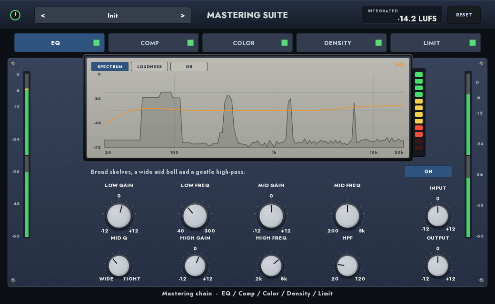

# Mastering Suite

A fixed-order stereo mastering chain with calibrated metering, built on
`hearth-dsp` and the Comp Suite/Patina visual language.

**Status: 0.1.0 preview.** The panel and DSP are under local review; the CLAP
build is installable, LV2 follows after approval.



## Chain

`Input → EQ → Bus Compressor → Patina Color → Density → Peak Limiter → Output`

- **EQ** — smooth low shelf, wide mid bell, high shelf and high-pass. Broad,
  non-resonant shapes intended for mastering moves, with the combined curve
  drawn over the spectrum.
- **Bus Compressor** — stereo-linked feed-forward bus compressor with ratio,
  knee, side-chain high-pass, parallel mix and optional auto gain.
- **Patina Color** — single-band extraction of Patina's colour engine: five
  models (Valve, Console, Bus, Tape, Transformer), drive, character, tone, mix
  and level.
- **Density** — original harmonic-density stage built on the asymmetric ADAA
  shaper. Input, density and output, with no proprietary curve.
- **Peak Limiter** — five-millisecond lookahead, true-peak detection and a
  selectable ceiling. Latency is 240 samples at 48 kHz and stays constant when
  the module is bypassed.

## Metering

- Input and output sample peak, per channel
- Output true peak (dBTP) from a 4x detector
- Integrated, short-term and momentary LUFS, plus LRA (EBU R128 via
  `libebur128`)
- Stereo correlation
- Compressor and limiter gain reduction
- 128-bin log FFT spectrum with the live EQ curve

The display switches between **Spectrum**, **Loudness** and **GR** with the
tabs inside the bezel. The header shows integrated LUFS at all times.

## Build

Dependencies: CMake 3.16+, a C++17 compiler, Cairo, FreeType, X11,
`libebur128` and the CLAP headers. `hearth-dsp` is a submodule.

```sh
git submodule update --init --recursive
cmake -S . -B build -DCLAP_DIR="$HOME/.clap"
cmake --build build -j
ctest --test-dir build --output-on-failure
cmake --install build
```

The install step writes `MasteringSuite.clap` and
`MasteringSuite.resources/` into `~/.clap`.

## Tests

- `mastering_dsp_test` — EQ unity, compressor gain reduction, limiter ceiling
  and true-peak reduction, colour/density stability, LUFS and spectrum
  population, latency.
- `mastering_clap_host_test` — bundle load, factory, parameter/state
  round-trip, host text, audio processing, X11 editor embedding, click and
  drag interaction. Runs under `xvfb-run` when available.

## Notes

- Format: CLAP first; LV2 is planned once the preview is approved.
- `libebur128` is a runtime dependency. The release notes must state this, or
  the analyser must be vendored before a self-contained bundle ships.
- No Sonnox Inflator, FabFilter Pro-L 2 or Tokyo Dawn SlickEQ code, curves or
  product names are used. The colour and density stages are original shapes.
- See `THIRD_PARTY_NOTICES.md` for licences and attribution.

## Licence

GPL-3.0-or-later. See `LICENSE`.
